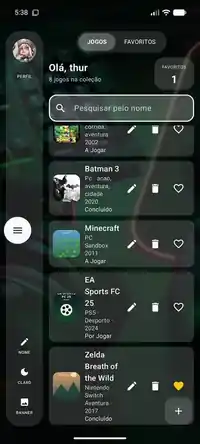

# Game Collection

App Android para guardar e organizar a tua coleção de videojogos.

<p>
  
  
  
  
</p>

## Descarregar

👉 **[Descarregar o APK mais recente](../../releases/latest)**

1. Abre o link acima no telemóvel e descarrega o ficheiro `.apk`.
2. Abre o ficheiro para instalar.
3. Se o Android pedir, permite instalar apps de "fontes desconhecidas".

Funciona em Android 7.0 ou mais recente.

## O que a app faz

- Adicionar, editar e eliminar jogos
- Guardar nome, plataforma, género e ano
- Escolher a capa a partir da galeria
- Marcar o estado: **Por Jogar**, **A Jogar** ou **Concluído**
- Pesquisar pelo nome
- Marcar favoritos e ver só os favoritos
- Modo claro e escuro
- Perfil com nome, foto e banner

Os dados ficam guardados no próprio telemóvel.

## Feito com

- Kotlin
- Jetpack Compose (Material 3)

## Estrutura

```
app/src/main/java/com/example/colecaojogos/
├── MainActivity.kt   → arranque da app e navegação entre ecrãs
├── Telas.kt          → ecrã da lista e formulário do jogo
└── Jogo.kt           → modelo do jogo, perfil e gravação dos dados
```

## Abrir o projeto

1. Instala o [Android Studio](https://developer.android.com/studio).
2. Clona o repositório ou descarrega o ZIP (botão verde **Code**).
3. Abre a pasta no Android Studio e carrega em **Run ▶**.

## Licença

[MIT](LICENSE) — podes usar e modificar livremente.
